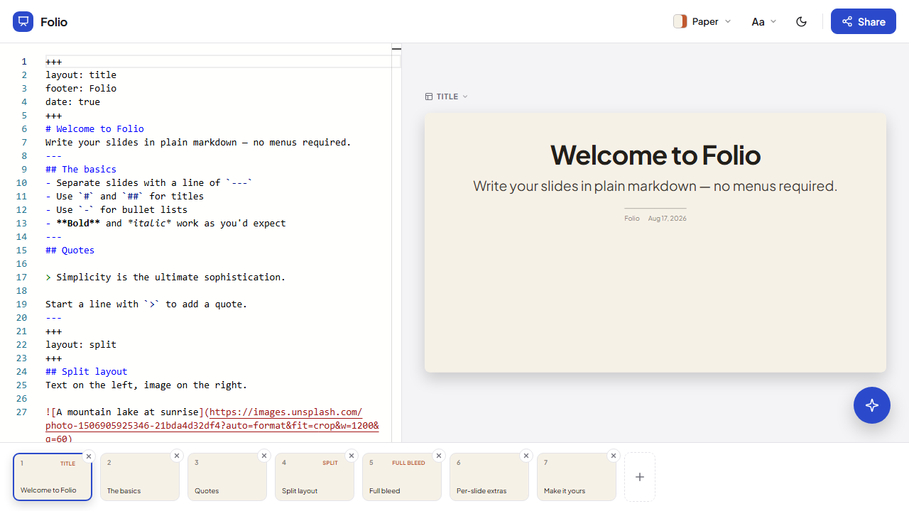

# Slidown

Slidown is a browser-based slide editor for people who would rather write than arrange text boxes. Write a deck in Markdown, see each slide as you go, and adjust the theme, accent, font, or layout when you need to.

I started it because making a presentation kept pulling me away from the actual story. The idea is simple: get the words down first, then make them look good without rebuilding every slide by hand. [Try Slidown](https://slidown.dev/).

## What you can do

- Write slides in Markdown with a live preview and a starter deck to learn the format.
- Choose slide layouts, themes, accents, and fonts.
- Ask Claude, Gemini, or OpenAI to draft a deck or critique one, using your own API key.
- Export a deck as a PDF.

Each URL path opens a separate board. Boards are saved in your browser's local storage, so opening the same path on another device will not bring the deck with it.

## Tech stack

| Area | Tools |
| --- | --- |
| App | React 19, TypeScript 6, Vite 8 |
| Styling and UI | Tailwind CSS v4, Radix UI, Lucide React |
| Editor and slides | Monaco Editor, react-markdown, unified |
| State and forms | Zustand, React Hook Form, Zod |

Slidown runs as a client-side app. The editor keeps boards in local storage, and AI requests go directly from the browser to the provider you choose.
Optional PostHog analytics records fixed-choice actions and slide counts. It excludes slide content, AI prompts and responses, API keys, and board paths.

## Feedback

Have an idea or found something that feels off? [Open an issue](https://github.com/bw3sley/slidown/issues). If you like the project, [leave it a star](https://github.com/bw3sley/slidown).

## License

Slidown is available under the [MIT License](./LICENSE.md).
